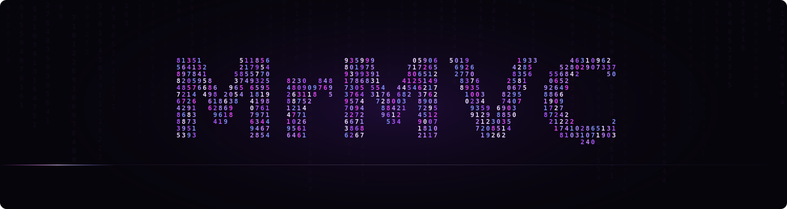

 <div align="center">



# MATRIX ENGINE

**Animated SVG Banner Generator**

Create your own digital identity through code.


[](https://github.com/MrMVC/matrix-engine/releases/latest)
[](https://github.com/MrMVC/matrix-engine/actions/workflows/ci.yml)

</div>

---

## 01 / Overview

Matrix Engine is a Python-based SVG banner generator 
inspired by digital rain and futuristic typography.

It transforms custom text into animated numerical 
patterns, combining procedural graphics with 
lightweight SVG animations.

Designed for GitHub profiles, developer portfolios 
and personal branding.

## 02 / Features

- Animated digital rain
- Custom text rendering
- Configurable banner dimensions
- Custom font support
- Procedural number generation
- Reproducible output through random seeds
- Lightweight SVG export
- No JavaScript required for animation
- Command-line interface
- Six color presets: Purple, Green, Blue, Red, Cyan and Mono
- Automatic text scaling
- Adjustable animation speed
- Static SVG generation mode
- Cross-platform CI testing
- Automated dependency updates

## 03 / Preview

<div align="center">



</div>

## 04 / Installation

### Requirements

- Python 3.11 or newer
- Pillow
- Git
- A compatible TrueType font

### Clone the repository

```bash
git clone https://github.com/MrMVC/matrix-engine.git
cd matrix-engine
```

### Install dependencies

```bash
python -m pip install -r requirements.txt
```

## 05 / Usage

Generate a default banner:

```bash
python build_mrmvc.py
```

Generate a personalized banner:

```bash
python build_mrmvc.py --text "YourName"
```

Customize the dimensions:

```bash
python build_mrmvc.py --text "MrMVC" --width 1500 --height 400
```

Specify an output file:

```bash
python build_mrmvc.py --output output/banner.svg
```

## 06 / Configuration

| Parameter | Default | Description |
|---|---|---|
| --text | MrMVC | Banner text |
| --width | 1500 | SVG width |
| --height | 400 | SVG height |
| --font-size | 218 | Text size |
| --font-path | Automatic | Custom TrueType font |
| --seed | 42 | Random generation seed |
| --output | output/matrix-banner.svg | Output file |
| --color | purple | Color preset |
| --speed | 1.0 | Animation speed multiplier |
| --no-animation | Disabled | Generate a static SVG |

## 07 / GitHub Integration

Upload your generated SVG to your GitHub 
profile repository and reference it in your README.

```html

```

Animation support may vary depending on the 
browser and SVG rendering environment.

## 08 / Roadmap

- [x] SVG generation
- [x] Animated digital rain
- [x] Custom text rendering
- [x] Command-line interface
- [x] Six CLI color presets
- [x] Configurable animation speed
- [x] Automatic text scaling
- [x] Static SVG generation
- [x] Automated cross-platform testing
- [x] Automated dependency updates
- [x] CodeQL security scanning
- [ ] PNG and GIF export
- [ ] Interactive web-based generator
- [ ] Custom color palette editor
- [ ] PyPI package distribution

## 09 / Contributing

Contributions, suggestions and bug reports are welcome.

Feel free to open an issue or submit a pull request.

## 10 / License

Distributed under the MIT License.

See [LICENSE](./LICENSE) for more information.

---

<div align="center">

**MrMVC**

`BUILD. INNOVATE. EVOLVE.`

[GitHub Profile](https://github.com/MrMVC)

</div>
